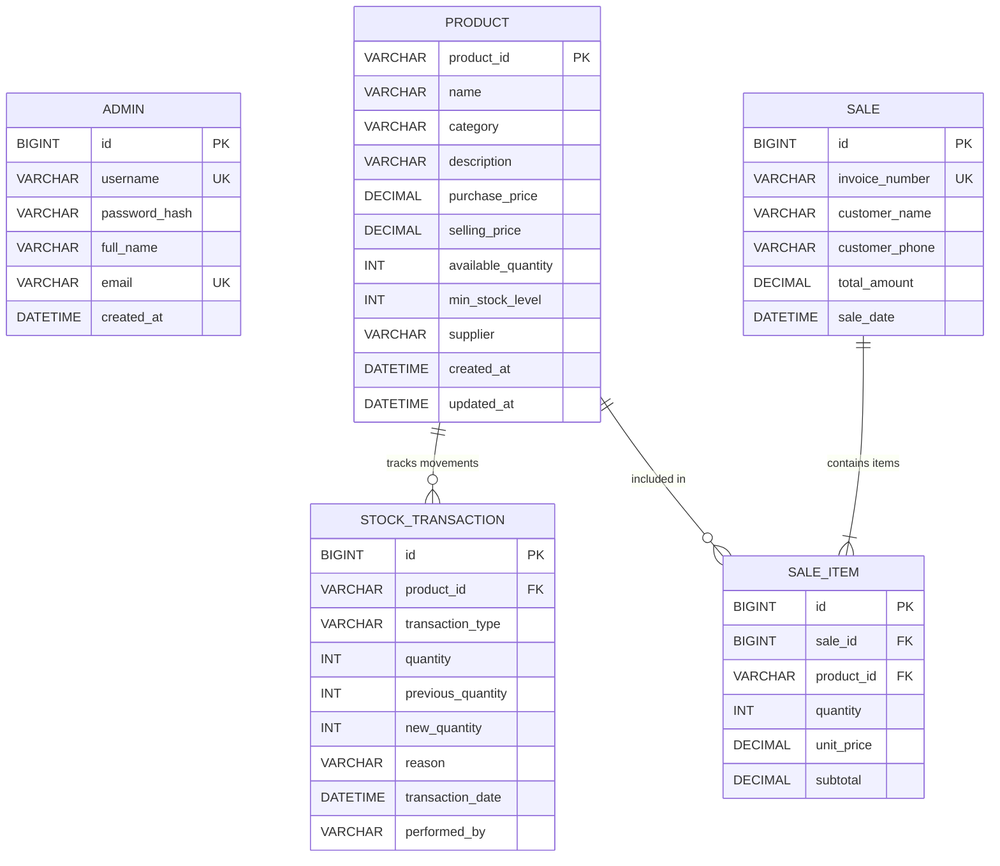

# StockMaster — Database Schema & Data Architecture Specification

## 1. Overview & Architectural Principles

**StockMaster** employs a robust relational database design mapped via **Spring Data JPA / Hibernate** with clean foreign key integrity, declarative indexes, auditable timestamps, and ACID transactional guarantees.

### Key Tenets
1. **Source of Truth**: The database is the permanent, durable store of record.
2. **ACID Transactionality**: All stock mutations and sales checkouts execute within `@Transactional` boundaries with pessimistic or optimistic concurrency controls to eliminate dirty reads, race conditions, and negative inventory.
3. **In-Memory Cache & Index Rehydration**: On application startup (`DataInitializer`), the database records are loaded and projected into custom Core Java in-memory structures (`HashTable`, `AVLTree`, `MaxHeap`). Any subsequent database update triggers write-through synchronization to these in-memory indexes via `DsaIndexService`.

---

## 2. Entity-Relationship Diagram (ERD)



---

## 3. Table Definitions & Constraints

### 3.1 `admin` Table
Stores authenticated administrative operators. Passwords are cryptographic salted hashes using **BCrypt** ($Cost = 10$).

| Column | Data Type | Nullable | Default | Description & Constraints |
| :--- | :--- | :--- | :--- | :--- |
| `id` | `BIGINT` | `NO` | `AUTO_INCREMENT` | **Primary Key** |
| `username` | `VARCHAR(50)` | `NO` | — | **Unique**, login identity |
| `password_hash` | `VARCHAR(255)`| `NO` | — | BCrypt encrypted hash (`$2a$...`) |
| `full_name` | `VARCHAR(100)`| `NO` | — | Operator display name |
| `email` | `VARCHAR(100)`| `NO` | — | **Unique**, email address |
| `created_at` | `DATETIME` | `NO` | `CURRENT_TIMESTAMP` | System creation timestamp |

```sql
CREATE TABLE admin (
    id BIGINT AUTO_INCREMENT PRIMARY KEY,
    username VARCHAR(50) NOT NULL UNIQUE,
    password_hash VARCHAR(255) NOT NULL,
    full_name VARCHAR(100) NOT NULL,
    email VARCHAR(100) NOT NULL UNIQUE,
    created_at DATETIME NOT NULL DEFAULT CURRENT_TIMESTAMP
);
```

---

### 3.2 `products` Table
Stores product catalog records, pricing, available stock inventory, and re-order thresholds.

| Column | Data Type | Nullable | Default | Description & Constraints |
| :--- | :--- | :--- | :--- | :--- |
| `product_id` | `VARCHAR(50)` | `NO` | — | **Primary Key**, SKU / Unique code (e.g., `PRD-1001`) |
| `name` | `VARCHAR(150)`| `NO` | — | Product display title |
| `category` | `VARCHAR(50)` | `NO` | — | Classification (`Electronics`, `Grocery`, etc.) |
| `description` | `VARCHAR(500)`| `YES` | `NULL` | Product technical details or notes |
| `purchase_price` | `DECIMAL(12,2)` | `NO` | — | Cost of acquisition per unit |
| `selling_price` | `DECIMAL(12,2)` | `NO` | — | Retail list price per unit |
| `available_quantity` | `INT` | `NO` | `0` | Physical stock count; check: $\ge 0$ |
| `min_stock_level` | `INT` | `NO` | `5` | Low stock alert threshold; check: $\ge 0$ |
| `supplier` | `VARCHAR(100)`| `YES` | `NULL` | Vendor or distributor name |
| `created_at` | `DATETIME` | `NO` | `CURRENT_TIMESTAMP` | Initial catalog addition date |
| `updated_at` | `DATETIME` | `YES` | `NULL` | Timestamp of last modification |

```sql
CREATE TABLE products (
    product_id VARCHAR(50) PRIMARY KEY,
    name VARCHAR(150) NOT NULL,
    category VARCHAR(50) NOT NULL,
    description VARCHAR(500),
    purchase_price DECIMAL(12,2) NOT NULL,
    selling_price DECIMAL(12,2) NOT NULL,
    available_quantity INT NOT NULL DEFAULT 0,
    min_stock_level INT NOT NULL DEFAULT 5,
    supplier VARCHAR(100),
    created_at DATETIME NOT NULL DEFAULT CURRENT_TIMESTAMP,
    updated_at DATETIME ON UPDATE CURRENT_TIMESTAMP,
    INDEX idx_product_category (category),
    INDEX idx_product_name (name)
);
```

---

### 3.3 `stock_transactions` Table
An immutable audit log recording all physical stock entries (`STOCK_IN`) and stock decrements (`STOCK_OUT`).

| Column | Data Type | Nullable | Default | Description & Constraints |
| :--- | :--- | :--- | :--- | :--- |
| `id` | `BIGINT` | `NO` | `AUTO_INCREMENT` | **Primary Key** |
| `product_id` | `VARCHAR(50)` | `NO` | — | **Foreign Key** referencing `products(product_id)` |
| `transaction_type` | `VARCHAR(20)` | `NO` | — | Enum: `STOCK_IN` or `STOCK_OUT` |
| `quantity` | `INT` | `NO` | — | Units added or deducted ($\gt 0$) |
| `previous_quantity` | `INT` | `NO` | — | Snapshot before mutation |
| `new_quantity` | `INT` | `NO` | — | Snapshot after mutation |
| `reason` | `VARCHAR(255)`| `YES` | `NULL` | Reason / Purchase Order / Damage note |
| `transaction_date` | `DATETIME` | `NO` | `CURRENT_TIMESTAMP` | Audit event timestamp |
| `performed_by` | `VARCHAR(50)` | `NO` | — | Operator username |

```sql
CREATE TABLE stock_transactions (
    id BIGINT AUTO_INCREMENT PRIMARY KEY,
    product_id VARCHAR(50) NOT NULL,
    transaction_type VARCHAR(20) NOT NULL,
    quantity INT NOT NULL,
    previous_quantity INT NOT NULL,
    new_quantity INT NOT NULL,
    reason VARCHAR(255),
    transaction_date DATETIME NOT NULL DEFAULT CURRENT_TIMESTAMP,
    performed_by VARCHAR(50) NOT NULL,
    FOREIGN KEY (product_id) REFERENCES products(product_id) ON DELETE CASCADE,
    INDEX idx_st_product (product_id),
    INDEX idx_st_type (transaction_type),
    INDEX idx_st_date (transaction_date)
);
```

---

### 3.4 `sales` Table
Header table for Point-of-Sale orders, invoices, and billing history.

| Column | Data Type | Nullable | Default | Description & Constraints |
| :--- | :--- | :--- | :--- | :--- |
| `id` | `BIGINT` | `NO` | `AUTO_INCREMENT` | **Primary Key** |
| `invoice_number` | `VARCHAR(50)` | `NO` | — | **Unique**, e.g., `INV-20261124-001` |
| `customer_name` | `VARCHAR(100)`| `NO` | — | Customer / Client name |
| `customer_phone` | `VARCHAR(20)` | `YES` | `NULL` | Customer contact number |
| `total_amount` | `DECIMAL(12,2)` | `NO` | — | Aggregate invoice price |
| `sale_date` | `DATETIME` | `NO` | `CURRENT_TIMESTAMP` | Checkout timestamp |

```sql
CREATE TABLE sales (
    id BIGINT AUTO_INCREMENT PRIMARY KEY,
    invoice_number VARCHAR(50) NOT NULL UNIQUE,
    customer_name VARCHAR(100) NOT NULL,
    customer_phone VARCHAR(20),
    total_amount DECIMAL(12,2) NOT NULL,
    sale_date DATETIME NOT NULL DEFAULT CURRENT_TIMESTAMP,
    INDEX idx_sale_date (sale_date),
    INDEX idx_sale_invoice (invoice_number)
);
```

---

### 3.5 `sale_items` Table
Line-item detail for each sale invoice, recording the exact quantity and unit price snapshot.

| Column | Data Type | Nullable | Default | Description & Constraints |
| :--- | :--- | :--- | :--- | :--- |
| `id` | `BIGINT` | `NO` | `AUTO_INCREMENT` | **Primary Key** |
| `sale_id` | `BIGINT` | `NO` | — | **Foreign Key** referencing `sales(id)` |
| `product_id` | `VARCHAR(50)` | `NO` | — | **Foreign Key** referencing `products(product_id)` |
| `quantity` | `INT` | `NO` | — | Units purchased ($\gt 0$) |
| `unit_price` | `DECIMAL(12,2)` | `NO` | — | Price per unit at moment of sale |
| `subtotal` | `DECIMAL(12,2)` | `NO` | — | `quantity * unit_price` |

```sql
CREATE TABLE sale_items (
    id BIGINT AUTO_INCREMENT PRIMARY KEY,
    sale_id BIGINT NOT NULL,
    product_id VARCHAR(50) NOT NULL,
    quantity INT NOT NULL,
    unit_price DECIMAL(12,2) NOT NULL,
    subtotal DECIMAL(12,2) NOT NULL,
    FOREIGN KEY (sale_id) REFERENCES sales(id) ON DELETE CASCADE,
    FOREIGN KEY (product_id) REFERENCES products(product_id) ON DELETE CASCADE,
    INDEX idx_si_sale (sale_id),
    INDEX idx_si_product (product_id)
);
```

---

## 4. Key Relationships & Cascading Rules

1. **`products` to `stock_transactions` (One-to-Many)**:
   - When a product is queried, historical stock entries are tracked via `StockTransactionRepository.findByProductIdOrderByTransactionDateDesc()`.
   - Foreign key constraint prevents orphan records upon deletion (`ON DELETE CASCADE`).
2. **`sales` to `sale_items` (One-to-Many)**:
   - One invoice has one or more line items.
   - Deleting a sale cascades down to remove all its line items cleanly.
3. **`products` to `sale_items` (One-to-Many)**:
   - Historical sales items reference `product_id`. When calculating best-selling items, `sale_items` rows are aggregated grouped by `product_id`.

---

## 5. Transaction Management & Integrity Guarantees

### Atomic Stock Movement (`StockService`)
```java
@Transactional
public StockTransaction performStockOperation(StockOperationDto dto, String performedBy) {
    Product product = productRepository.findById(dto.getProductId())
        .orElseThrow(() -> new ResourceNotFoundException(...));
    
    int prevQty = product.getAvailableQuantity();
    int newQty;
    
    if (dto.getTransactionType() == TransactionType.STOCK_IN) {
        newQty = prevQty + dto.getQuantity();
    } else {
        if (prevQty < dto.getQuantity()) {
            throw new InsufficientStockException("Cannot stock out: requested " 
                + dto.getQuantity() + " but only " + prevQty + " available.");
        }
        newQty = prevQty - dto.getQuantity();
    }
    
    product.setAvailableQuantity(newQty);
    productRepository.save(product);
    
    // Write-Through to in-memory DSA
    dsaIndexService.updateProduct(product);
    
    // Create Audit record
    StockTransaction tx = new StockTransaction(...);
    return stockTransactionRepository.save(tx);
}
```

### Atomic Sales Processing (`SaleService`)
```java
@Transactional
public Sale processSale(SaleRequestDto request) {
    // 1. Validation & Pre-flight checks on all line items
    for (SaleItemRequestDto item : request.getItems()) {
        Product p = productRepository.findById(item.getProductId()).orElseThrow(...);
        if (p.getAvailableQuantity() < item.getQuantity()) {
            throw new InsufficientStockException("Insufficient stock for " + p.getName());
        }
    }
    
    // 2. Persist Sale Header
    Sale sale = saleRepository.save(new Sale(...));
    
    // 3. Persist Line Items & Atomically Deduct Stock
    for (SaleItemRequestDto item : request.getItems()) {
        Product p = productRepository.findById(item.getProductId()).get();
        p.setAvailableQuantity(p.getAvailableQuantity() - item.getQuantity());
        productRepository.save(p);
        
        // Write-Through update to DSA
        dsaIndexService.updateProduct(p);
        
        SaleItem saleItem = new SaleItem(sale, p, item.getQuantity(), p.getSellingPrice(), ...);
        saleItemRepository.save(saleItem);
    }
    
    // 4. Rebuild Max Heap Ranking
    dsaIndexService.rebuildMaxHeap(getProductSalesTotals());
    return sale;
}
```

---

## 6. Dual-Mode Database Support

StockMaster is engineered with seamless dual database flexibility:

| Mode | Active Configuration | Driver & URL | Persistence File / Storage |
| :--- | :--- | :--- | :--- |
| **Embedded File Mode (Default)** | `application.properties` | `org.h2.Driver`<br>`jdbc:h2:file:./data/stockmaster_db;MODE=MySQL` | Stored persistently in `./data/stockmaster_db.mv.db` |
| **Native MySQL Server Mode** | `application-mysql.properties` | `com.mysql.cj.jdbc.Driver`<br>`jdbc:mysql://localhost:3306/stockmaster_db` | Native MySQL tables & InnoDB storage engine |

To switch to dedicated MySQL, launch with:
```powershell
java -jar -Dspring.profiles.active=mysql target/stockmaster-inventory-system-1.0.0.jar
```
Or run the provided DDL script: `stockmaster_mysql.sql`.
