# StockMaster — Project Architecture & System Design Document
### University A6 Data Structures Project

---

## 🏛️ 1. Architectural Overview

**StockMaster** is architected as an enterprise-grade, monolithic, layered web application built with **Spring Boot** and **Thymeleaf**, integrating **Core Java Custom Data Structures** directly into the business operations layer.

```mermaid
flowchart TB
    subgraph Presentation_Layer [Presentation & UI Layer]
        HTML[Bootstrap 5 + Thymeleaf HTML5 Views]
        JS[Client JS + Chart.js Visualizations]
        CSS[Custom StockMaster Theme CSS]
    end

    subgraph Security_Layer [Authentication & Session Guard]
        Interceptor[AuthInterceptor]
        BCrypt[BCrypt Password Hashing]
    end

    subgraph Controller_Layer [Spring MVC Controller Layer]
        DashboardCtrl[DashboardController]
        ProductCtrl[ProductController]
        StockCtrl[StockController]
        SaleCtrl[SaleController]
        SearchCtrl[SearchController]
        HistoryCtrl[HistoryController]
        DsaCtrl[DsaAnalysisController]
    end

    subgraph Service_Layer [Business Logic & Service Layer]
        ProductSvc[ProductService]
        StockSvc[StockService]
        SaleSvc[SaleService]
        DashSvc[DashboardService]
        BenchSvc[DsaBenchmarkService]
    end

    subgraph DSA_Index_Layer [Custom Core Java DSA Engine - In-Memory]
        DsaIndex[DsaIndexService - Thread-Safe ReentrantReadWriteLock]
        HashTable[HashTable - Separate Chaining]
        AVLTree[AVLTree - Self-Balancing BST]
        MaxHeap[MaxHeap - Top-K Priority Queue]
        SortAlgos[MergeSort & QuickSort]
        SearchAlgos[BinarySearch & LinearSearch]
    end

    subgraph Persistence_Layer [Spring Data JPA & Storage Layer]
        Repos[Product, Sale, Transaction Repositories]
        DB[(MySQL 8.0 / Persistent Database)]
    end

    Presentation_Layer <--> Security_Layer
    Security_Layer <--> Controller_Layer
    Controller_Layer <--> Service_Layer
    Service_Layer <--> DSA_Index_Layer
    Service_Layer <--> Persistence_Layer
    DSA_Index_Layer -.->|Write-Through Sync| Persistence_Layer
```

---

## 🧩 2. Layered Responsibilities

### 1. Presentation & UI Layer
- **HTML5 & Thymeleaf:** Server-rendered responsive templates utilizing layouts and fragments for header, sidebar, topbar, alerts, and footer.
- **Bootstrap 5.3 & Bootstrap Icons:** Modern SaaS dashboard styling with professional dark navy navigation and refined blue accents.
- **Chart.js 4.4:** Interactive dynamic charts for monthly sales trends, category distribution, and live DSA performance benchmarks.

### 2. Security & Session Layer
- **`AuthInterceptor`:** Intercepts every inbound HTTP request. Public routes (`/login`, `/css/**`, `/js/**`, `/images/**`) are permitted; all administrative routes require an active HTTP session containing an authenticated `Admin` object.
- **BCrypt Password Hashing:** 10-round salted adaptive hashing for admin passwords to defend against rainbow tables and brute force attacks.

### 3. Controller Layer (Spring MVC)
- Handles HTTP requests (GET, POST), maps URL routes, binds form inputs to typed DTOs, triggers Jakarta Bean Validation (`@Valid`), and populates `Model` attributes before view rendering.

### 4. Service Layer (Business Domain)
- Implements transaction boundaries (`@Transactional`) ensuring ACID compliance.
- Enforces strict business invariants:
  - Prevention of duplicate product codes.
  - Prevention of negative stock quantities during Stock Out.
  - Prevention of inventory overselling during sales checkout.
  - Automatic calculation of itemized subtotals, invoice totals, and discounts.

### 5. Custom DSA Engine (In-Memory Indexing)
- Maintained by `DsaIndexService` with `ReentrantReadWriteLock` for thread safety.
- **`HashTable<String, Product>`:** Primary Key lookup by product code in $O(1)$ average time.
- **`AVLTree<String, Product>`:** Sorted product code index with guaranteed $O(\log N)$ search and $O(N)$ sorted Inorder Traversal.
- **`MaxHeap<ProductSalesDto>`:** Real-time priority queue ranking products by total units sold in $O(K \log N)$ time.
- **`BinarySearch` & `LinearSearch`:** Comparative algorithmic search implementations with nanosecond execution timings.
- **`MergeSort` & `QuickSort`:** Custom sorting algorithms for product prices, quantities, and names.

### 6. Persistence Layer (Spring Data JPA)
- Communicates with MySQL 8.0 via Hibernate ORM.
- Tables: `admin`, `products`, `sales`, `sale_items`, `stock_transactions`.
- Automatically rebuilds in-memory DSA indexes from persistent storage on application startup.
